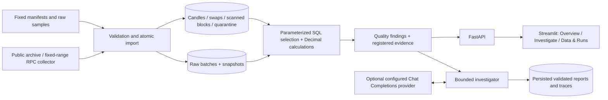

# Architecture and data dictionary

Current product role: **rule diagnosis + model evidence organization**. Correctness-v2 rules and accounting are detailed in [correctness-v2.md](correctness-v2.md); older reports remain version-pinned historical records.

MarketData Sentinel answers a bounded question: does an observed volume change have evidence of missing, stale, or invalid input data? It does not infer an economic cause, predict prices, or execute trades.

The default database is local SQLite for setup convenience. PostgreSQL is the deployment target and has a separate integration test. `alembic/versions/0001_initial.py` contains the frozen initial migration; it does not import the current ORM schema to decide its historical contents. The API readiness endpoint requires an Alembic version table, so `create_all()` used by small fixture operations does not replace the documented migration step.

## Modules and ownership of work

| Module | Responsibility |
| --- | --- |
| `sentinel/collectors.py` | Binance daily ZIP/checksum retrieval; one fixed finalized Ethereum range; bounded transport retry; safe failure recording |
| `sentinel/pipeline.py` | Parse, validate, pin input versions, normalize, quarantine, inject isolated faults, restore from raw inputs |
| `sentinel/models.py`, `sentinel/db.py` | ORM schema, exact decimal type, sessions and backend selection |
| `sentinel/service.py` | Scope validation, parameterized selections, window metrics, coverage, freshness, findings and evidence |
| `sentinel/investigation.py` | Four read-only tools, validated fact catalog, deterministic and optional model report generation, persisted traces |
| `sentinel/llm.py` | Configurable real HTTP tool-call protocol, deadlines/call budgets, usage and configured-price estimates |
| `sentinel/api.py`, `sentinel/ui.py` | HTTP contract and English local workbench; UI reads through the API |
| `sentinel/cli.py` | Explicit local writes and the single-worker scheduler; these operations are not Agent tools |
| `sentinel/evaluation.py`, `evals/` | Frozen development/acceptance inputs, separate oracles, execution and artifact-based scoring |

## Storage dictionary

| Table | Important fields and meaning | Identity / uniqueness |
| --- | --- | --- |
| `snapshots` | `source`, JSON `manifest`, `created_at`; manifest retains UTC input range, schema, checksum, request parameters, raw location and real/synthetic flag | Opaque content-derived `id`; input payload plus transformation determines version |
| `raw_batches` | Original rows and manifest in JSON `payload`, input `checksum`, pinned `manifest`, `ingested_at` | `id = raw-<snapshot_id>`; references snapshot |
| `cex_candles` | Source, ETHUSDT, 1m, `open_time`, OHLC, base ETH volume, quote USDT volume, parsed source trade count, raw batch reference | `(snapshot_id, source, symbol, interval, open_time)` |
| `dex_swaps` | Chain, pool, block number/hash, transaction hash, log index, block event time, signed raw integer amounts, token metadata, raw batch reference | `(snapshot_id, chain_id, pool, block_hash, tx_hash, log_index)` |
| `coverage` | Successfully scanned DEX block number, canonical hash and event time, including blocks with no Swap | `(snapshot_id, block_number)` |
| `ingestion_runs` | Source, status, JSON checkpoint, retry count, safe error and creation time | Run UUID; nullable snapshot for a transport failure before input pinning |
| `quarantine` | Invalid raw row, its original row index, batch/snapshot and parse reason | Deterministic snapshot/index identifier avoids duplicate quarantine on rerun |
| `quality_findings` | JSON rule, severity, expected/actual values, UTC scope, evidence and detector version | Content-derived finding ID |
| `evidence` | Query evidence includes exact result/source/snapshot/UTC bounds; import observations retain both raw/value versions, identity and row/time provenance | Query-content or immutable-input/occurrence-derived ID; snapshot reference |
| `investigation_runs` | Question, pinned scope, model configuration without key, report, tool argument/output summaries, timing, available usage/cost | Investigation UUID and snapshot reference |

Event times belong to candles, swaps and scanned blocks. Raw batch `ingested_at` and run `created_at` describe local processing; they are not market event times. A run has a creation time rather than a separate finished-at column; the UI labels its latest successful import accordingly. Raw files remain small and registered; the database also retains original rows so restore does not depend on an arbitrary filesystem read.

## Precision, timestamps and units

CEX prices and volumes use Python `Decimal` and PostgreSQL `NUMERIC(78,30)`. The parser rejects non-finite values and values beyond the supported decimal scale/integer precision instead of relying on database rounding. SQLite stores the decimal representation as text through `ExactDecimal`, avoiding SQLite REAL conversion. SQLAlchemy selects the bounded rows using parameters; sums and changes are calculated in Python with a decimal context of precision 100. API/report amounts are decimal strings. Chart conversions are presentation-only and never written back.

DEX `amount0`/`amount1` remain signed integer strings, preserving the full raw int256 representation without float conversion. Token quantities are derived using the registered decimals. The single configured Ethereum mainnet pool is `0x8ad599c3a0ff1de082011efddc58f1908eb6e6d8`: USDC token0, 6 decimals; WETH token1, 18 decimals; fee 3000. The bundled DEX events, block hashes and timestamps are explicitly synthetic. Configured metadata is referenced to the official SDK example, while connected collection separately checks chain ID, finalization, token addresses, decimals, fee and block hashes through RPC. The failed external RPC attempt does not establish successful historical collection.

CEX reports ETH base volume and USDT quote volume separately. The DEX volume is the sum of absolute token0 USDC quantities only; it is not dollar value and does not sum both sides of the swap. ETH/WETH and USDT/USDC are not treated as interchangeable. K-line count is distinct from source-reported `number_of_trades`; trade counts are unknown when not available.

All API bounds require timezone-aware datetimes and normalize to UTC. Queries use `[start, end)`, a positive range of at most seven days; CEX bounds must align to minutes. Binance spot timestamps follow the manifest date contract: milliseconds before 2025-01-01 and microseconds from that date. The parser validates both open and close times against the source contract and registered range. It does not guess the unit from the number of digits. The UI explicitly uses an Altair UTC scale and UTC tooltip labels.

## Snapshots, transactions and recovery

The importer hashes the original rows and manifest, then incorporates the transformation into the opaque snapshot ID. Normal and injected versions can coexist; a missing/stale scenario does not delete normal data. Scenario labels remain in operational raw lineage and are omitted from Agent tool payloads. Checksums locate the exact original inputs, and investigations stay bound to one snapshot throughout the run.

The importer first commits the raw manifest and a run in `running` state. Normalized rows, quarantines, scanned-block coverage, final checkpoint and final run status then commit together in one transaction. An injected interruption rolls that transaction back; a separate transaction marks the run failed. Rerun reads the registered input again and deduplicates by identity. This small implementation restarts a failed batch rather than claiming a durable per-row or per-RPC-page cursor. DEX network fetching completes before import; an interrupted network fetch retries the fixed range and does not resume from a durable segment cache.

`restore(snapshot_id)` reimports the original registered raw batch without the fault transformation. It returns the healthy content-derived version, which can already exist because normal replay is idempotent. Old reports continue to describe their original fault version. `reset(snapshot_id)` accepts only an isolated transformed snapshot and deletes only that snapshot's dependent records; it refuses a normal snapshot.

A local `FileLock` in the CLI worker prevents overlapping worker instances sharing the same project data directory. The default period is one day, with a minimum of 60 seconds. Archive polling follows daily publication; it is not a streaming market feed. Worker results append to `data/worker.jsonl`, and collection failures are also queryable as ingestion runs. This is a single-machine worker lock, not a distributed lease.

## Coverage, freshness and changes

CEX completeness compares actual minute timestamps with the expected UTC grid. DEX completeness compares the manifest's expected blocks with successfully scanned blocks. A complete scan with zero swaps is valid zero activity; absent coverage is a data gap. Pinned block hashes reject inconsistent imports; connected collection rereads hashes before import. This covers a fixed finalized range, not continuous reorg repair.

Replay freshness uses the snapshot `expected_end` clipped to the requested end. Connected historical collection uses the current UTC clock minus the publication allowance, capped at the pinned expected end/query end. Thus this is completeness/freshness of the requested historical job, not proof that the source has delivered the newest market minute. DEX coverage extends each scanned block to the next pinned block's timestamp; the last extends to the manifest end, accommodating skipped slots.

Volume change compares the equal-duration first and second halves of the query window, with explicit comparison bounds. Zero baseline and insufficient sampling/coverage have explicit statuses. A configurable drop threshold creates an informational `volume_change_pending_investigation`, not an economic root-cause label. Missing coverage, stale tails, known in-window bad rows and same-key conflicts create error findings. Known outside-window quarantine rows do not taint the query; unknown-time rows create warning evidence and uncertainty. An out-of-manifest or unanchored block-time window cannot certify completeness/freshness and produces an insufficient-evidence investigation.

DEX coverage uses interval overlap, not only block timestamps inside the query. The predecessor block may be required for an otherwise empty window; its valid scan covers until the next pinned block timestamp (or registered manifest end for the last block). Missing its scan is a gap; absent time anchors produce `coverage_known=false` and unknown lag. No Swap count is used to infer scan success.

The evidence table additionally retains `record_duplicate` / `record_conflict` observations, including full earlier/incoming fields, batch/index, validation status and key. Complete raw-field identity is distinguished from different values; the first valid normalized record is retained without claiming it is the true market value. Invalid values with recoverable keys are still compared for conflicts. Duplicate/conflict observations, standard rows and checkpoints share the import transaction. Quarantine JSON adds time/basis metadata; pre-v2 rows are classified from their original raw fields on read, without a schema migration.

## Evidence and tool boundary

Read tools are exactly `get_ingestion_status`, `get_quality_findings`, `get_window_metrics`, and `get_evidence`. Each source/window tool must receive only the pinned source, snapshot and window; the server checks all fields again. Evidence requests accept only IDs already returned by bound context tools. A model cannot select another snapshot, a different window, arbitrary SQL, a path or a command. Public API evidence lookup is independently bounded and snapshot-scoped; raw samples are limited to registered batch contents and sanitized manifest fields.

Every baseline begins with the same status, findings and metrics. Registered evidence is retrieved and compared to the actual initial structured payloads, including exact numeric values, source and window. The investigator constructs a canonical fact catalog and metric references. The optional LLM can select/order those supported facts and choose further read queries, but cannot add unchecked prose or change the diagnosis established by completed checks. This limits claims while reducing the task's open-ended reasoning scope. It does not demonstrate independent economic diagnosis.

The persisted report validates scope, canonical fact content, exact metric values, references and supporting quality evidence. `observed_data_issue`, `no_issue_found_in_checks`, and `insufficient_evidence` remain distinct. A failing tool/model, invalid report, unavailable provider or exhausted budget produces an explicit fallback with requested and actual modes. No model hidden reasoning is requested or saved. Tool traces record arguments, output sizes/evidence IDs, status and latency.

The live transport has a 45-second model deadline, at most four model calls, six additional tool steps, a 10-second request timeout, one transient HTTP retry, and 1,200 output tokens per call. Real provider/model/base URL/key are configured through environment variables; no model name or price is assumed. Missing usage or prices remain unknown. The real model adapter is implemented and contract-tested; live model evaluation remains NOT RUN. See `implementation-status.md` and `evaluation.md` for dated executed results and remaining external conditions.
