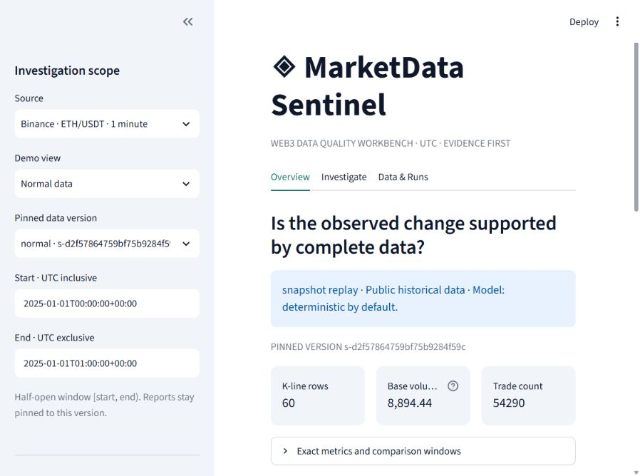
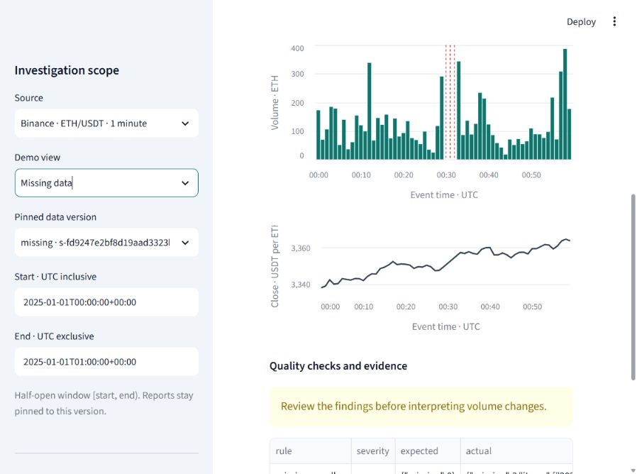
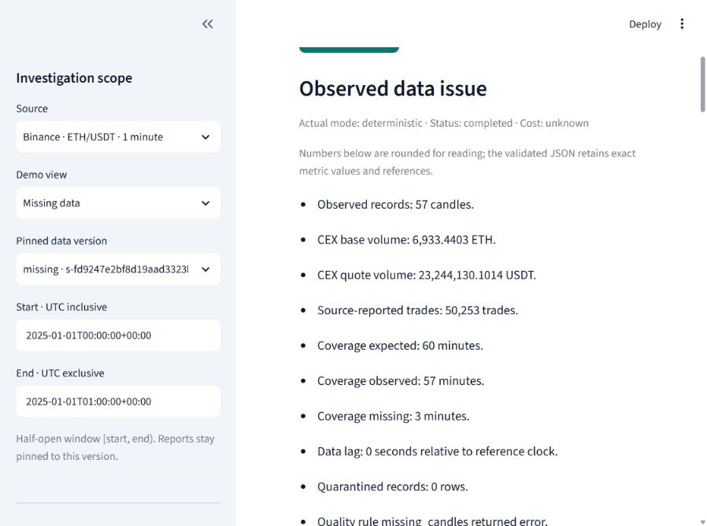
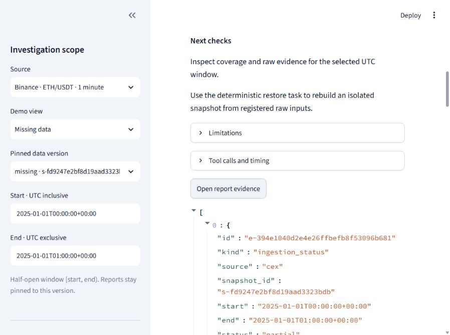

# Two-minute demonstration

Prepare dependencies, run `scripts/start.ps1` from the repository, and open http://127.0.0.1:8501 . This is a historical snapshot replay with deliberate fault injection, not live market monitoring. CEX data is public history; DEX data is synthetic. Keep a terminal in the same project and database environment as the API.

| Time | Action | What to explain / verify |
|---|---|---|
| 0:00–0:20 | Overview → CEX → Demo view: Normal data | Pinned version, UTC window,60 candles,54,290 source trades; ETH base volume8,894.4444 in exact metrics. State the model mode is deterministic. |
| 0:20–0:40 | Demo view: Missing data | An isolated version has57/60 expected candles and three missing minutes. Red dashed chart markers identify gaps. Incomplete coverage suppresses percentage-change conclusions. |
| 0:40–1:05 | Investigate → Run investigation | Read `observed_data_issue`; facts cite metrics and evidence. Show that scope and input version are pinned and the report makes no economic-cause claim. |
| 1:05–1:25 | Open report evidence; Data & Runs → Open registered raw samples | Open registered input/metric evidence, hash, original sample and run checkpoint. No arbitrary SQL or filesystem tool is exposed. |
| 1:25–1:40 | Execute deterministic recovery below | It replays registered original raw data. It does not read evaluation answers or let the model write the database. |
| 1:40–2:00 | Select Normal data and run a new investigation |60/60 coverage and `no_issue_found_in_checks`; the faulty snapshot/report remains for comparison. This is not proof of absolute correctness. |

Recovery command:

```powershell
uv run python -m sentinel.cli restore s-fd9247e2bf8d19aad3323bdb
```

It returns normal version `s-d2f57864759bf75b9284f59c`. Restore is content addressed: the original normal snapshot may already exist, so it is reused without duplicates. It deliberately does not mutate the faulty snapshot. To regenerate a fault after a scoped reset: `uv run python -m sentinel.cli scenario missing`.

Fully scripted equivalent:

```powershell
uv run python -m sentinel.cli demo
```

The actual artifact `data/demo-result.json` contains before/after reports and traces. During local PostgreSQL execution, measured missing values were57 candles/6,933.4403 ETH/3 missing, restored values60 candles/8,894.4444 ETH/0 missing. The normalized data and checkpoints are committed atomically; old reports stay pinned.

Optional: select Stale data to see a truncated tail and reference lag. Select DEX to show **synthetic** replay and the difference between seven Swap records and twenty scanned blocks. Show live_llm only as a configuration/fallback demonstration while no model is configured; never call that a real model run.

## Actual screenshots

Captured from the running local Streamlit UI, not generated artwork. The default side-panel viewport is narrow; the chart/detail captures are taken after scrolling within that same browser.









Additional screenshots in `screenshots/` show the missing-data report, chart/quality findings and registered evidence as exercised. No video recording or external-user feedback is claimed.
